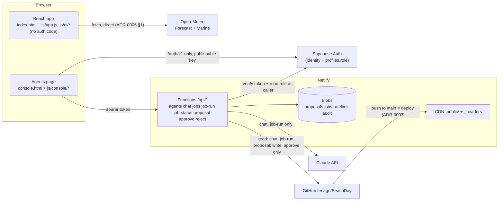

# Build contracts for Beach Day v1

- Status: W1 contract, 2026-11-23. Owner: software-architect (Rowan). Yardstick for W1 reviews and W2 builders.
- Sources: docs/01 §5, docs/03, docs/04 (§1, §2.1, §4, §7–§9, §11), docs/05 §3–6, ADR-0006/0007/0008 (ADR-0009 Proposed), build_plan §1, §2, §5.
- Machine-checked: `tests/contracts/` (13 JSON Schemas, samples, real Open-Meteo captures, and live seam checks that run against the real modules once they exist). Run `npx vitest run tests/contracts`.
- Rule of thumb: **the schema wins over this prose; docs/ wins over both** unless a ruling in §8 says otherwise. If you need to break a contract, say so in your HANDOFF. Don't drift quietly.

## 1. The system in one picture

There are no other servers. The beach app never calls Supabase or `/api/*`. Only `approve` writes to GitHub.

## 2. Module map and signatures

These are the signatures **as landed in W1** (checked 2026-11-23). W1R reviewers confirm them. Builders in W2 code against them.

### 2.1 Front end (`public/`, ES modules, relative `.js` imports, no bundler)

| Module | Owner | Exports (signature) |
|---|---|---|
| `js/api/openmeteo.js` | Dewey | `buildForecastUrl({lat,lon},{days,endpoint})`, `buildMarineUrl(...)`, `fetchJson(url,{timeoutMs=5000,fetchImpl})`, `validateResponse(json,{hourly,daily})`, `validateUnits(json,expected)`, `normalize(forecast, marine, {marinePoint, maxSnapKm=5}) → {timezone, utcOffsetSeconds, grid, marine:{available,label,snapKm}, hours: ForecastHour[], days}`, `loadBeach(beach, opts)`, `cToF`, `distanceKm`, `OpenMeteoError(kind)` |
| `js/score-config.js` | Dewey | `SCORE_CONFIG` (frozen; D3 `reasons.positiveOnGoodDays`, D8 `rain.amountInchOver`), `pick(bands,x)`, `verdictFor(score)` |
| `js/score.js` | Dewey | `scoreHour(h, ctx)`, `scoreDay({hours, priorHour, dayIndex, formatTime})`, `heatIndexF(t, rh)`. Pure: no DOM, no fetch |
| `js/data/beaches.js` | Dewey | `BEACHES` (13, each with land point, marine point, NWS office link and zone), `getBeach(id)`, `DEFAULT_BEACH_ID = "miami-beach"` |
| `js/data/beach-window.js`, `js/data/cache-age.js` | Dewey | window and DST helpers; `cacheAge`, `shouldRefetch`, `ageTier`, `freshnessLabel` |
| `js/forecast.js` | Dewey | **`loadForecast(beachId, {fetchImpl, storage, now, online, userForced, days, timeoutMs}) → Forecast`**; **`getCached(beachId, storage, {now}) → Forecast or null`**; `buildDays(model, now)` |
| `js/copy/copy-deck.js` | Wren | `STRINGS`, **`t(id, params)`** (throws on a missing id or placeholder), `VERDICTS`, `verdictFor(keyOrScore)`, `SAFETY`, `DECK`, `REASON_IDS`, `ADVICE_IDS`, `POSITIVE_REASON_IDS` |
| `js/app.js`, `js/ui/*.js` | Pip (W2) | boot, hash router (`#/`, `#/beach/:id`, `#/day/:date`), views. Imports `forecast.js`, `copy/*`, `data/beaches.js`, `pwa/*` only |
| `js/pwa/sw-register.js`, `js/pwa/install-hint.js` | Pip | SW registration and the `SKIP_WAITING` message; install hint with a 14-day snooze |
| `sw.js` | Pip | classic worker; may `importScripts` only `/sw/**`; never intercepts `/api/*`, `/version.json`, `/generated/*`, `/vendor/*`, `/console*`, `/js/console/*` or Supabase |
| `js/console/auth.js` | Cass | `createAuth({config, storage=localStorage, location=window.location, fetchImpl?})`. See §4 |
| `js/console/auth-screens.js` | Cass (W2) | `mountAuthScreens(root, {auth, route, onSignedIn, copy})` |
| `js/console/{main,api,agents,chat,proposal,approve-sheet,live,dom}.js` | Remy-B (W2) | §4 |
| `vendor/supabase-auth-js-2.119.2.mjs` | Cass (human-committed) | `AuthClient`, `isAuthRetryableFetchError` |
| `generated/config.js` | build (`gen-config.mjs`) | `SUPABASE_URL`, `SUPABASE_PUBLISHABLE_KEY`, `BUILD_VERSION` |

`Forecast = { beach, days: DayVerdict[], fetchedAt, source: "network"|"cache", partial: {marine}, ageMs, stale, staleBanner, tooOld, marine: {available,label,snapKm}, timezone, error? }`. `days` is `[]` when `tooOld`. `error` is the failure kind when a refresh failed and the cache was returned. With no cache, `loadForecast` **throws** `OpenMeteoError` (`kind`: `offline`, `timeout`, `network`, `http`, `api` or `shape`).

### 2.2 Functions (`netlify/functions/`, `.mts`, erasable TypeScript, relative imports with `.mts`)

Libraries in `lib/` (W1):

| Module | Owner | Exports |
|---|---|---|
| `settings.mts` | Nell | `SETTINGS` (frozen; every pending decision, §6) |
| `http.mts` | Nell | `json(status, body, headers?)`, `error(status, code, message, {retryAt?, extra?})`, `sseHeaders()`, `SECURITY_HEADERS`, `ERROR_CODES` |
| `blobs.mts` | Nell | `BlobStore` (`getWithMetadata`, `setJSON` with `onlyIfNew`/`onlyIfMatch`, `list`, `delete`), `Stores = {proposals, jobs, ratelimit, audit}`, `openStore(name)`, `realStores()` (lazy, strong consistency) |
| `limits.mts` | Nell | `hitUserDaily(store, "chat"|"jobs", userId, now)`, `checkApproveCap(store, now) → {allowed, used31, usedToday, reason?, retryAt?}`, `recordApproval(store, now)`, `checkComputeBudget(store, needMs, now) → {allowed, usedMs, remainingMs, retryAt?}`, `recordCompute(store, ms, now)`, `APPROVE_CAP`, `COMPUTE_BUDGET`, `localDay`, `nextLocalMidnight`, `pruneOlderThan`. Unreadable record → **throws**; the caller answers `503 unavailable` |
| `deploys.mts` | Nell | `DEPLOY_PATHS` (D9 list), `deploysOnPath(path)`, `deploysOnCommit(paths)` |
| `guard.mts` | Cass | `createGuard(opts) → Guard`, `guardFromEnv(opts)`, `denyResponse(GuardDeny)`, `precheckJwtHeader(token)`. `Guard = { check(req, {route, requestId}) → Promise<GuardAllow or GuardDeny>, getUser(token) }`. `GuardAllow = {ok: true, userId, claims, token}`, `GuardDeny = {ok: false, status: 401|403|503, code, reason}` (`reason` is for logs only) |
| `stepup.mts` | Cass | `approveStepUp(token, claims, guard.getUser, nowS) → {ok:true} or {ok:false, status:401|503, code}`, `checkStepUp(...)` |
| `origin.mts` | Cass | `checkOrigin(req, siteOrigin?) → {ok:true} or {ok:false, status:403, code:"forbidden"}`, `originDenyResponse(r)` |
| `ids.mts` | (W1, see §8 R10) | `ID_RE`, `newProposalId()`, `newJobId()`, `isProposalId(v)`, `isJobId(v)`, `ulid()` |
| `agents.mts` | Remy-A | `loadAgentRegistry() → Promise<AgentRegistry>`, `createAgentRegistry(raw)`, `AgentRegistry = {list() → PublicAgent[], get(name), names()}`, `isAllowedModel` |
| `claude.mts` | Remy-A | `createAnthropicClient("chat"|"job", apiKey)` (baseURL hard-coded), `assertAllowedModel`, `buildParams`, `parseChatMessages(raw, maxUserBytes)`, `createDeadline(totalMs, startedAt, now)`, **`runTurn({client, agent, messages, runTool, emit, effort, deadline, usage?, maxRounds?, maxTokens?, log?}) → {outcome, messages, usage}`** |
| `sse.mts` | Remy-A | `sseResponse(run(writer), log)`, `encodeEvent`, `errorEvent(code, message?)`, `assertEvent`, `parseSse`, `ERROR_MESSAGES` |
| `tools.mts` | Remy-A | `TOOLS`, `createToolRunner({reader, proposals, agent, state, emit?, onProposal?, now?})`, `newTurnState()`, `toolSummary` |
| `github-read.mts` | Remy-A | `createGitHubRead({token, fetchImpl, signal, timeoutMs})`, `githubReadFromEnv()` (reads `SETTINGS.githubReadTokenEnv`). **No write methods** |
| `github-write.mts` | Remy-A | `createGitHubWrite(opts)`, `githubWriteFromEnv()`, `treeEntries(files)`. Imported **only** by `approve.mts` |
| `allowlist.mts` | Remy-A | `checkPath(path, {denyConsoleUi})`, `checkProposal(files, opts)`, `checkReadPath`, `checkReadDir`, `TEXT_EXT`, `MAX_FILES`, `MAX_FILE_BYTES` |
| `secretscan.mts` | Remy-A | `scanText`, `scanProposal(files) → {ok, findings}`, `redact` |
| `proposals.mts` | Remy-A | `createProposal(store, input)`, `loadProposal(store, id)`, `transition(...)` (CAS), `computeContentHash`, `hashMatches`, `revalidate`, `checkSummary`, `buildCommitMessage`, `acquireApproveLock(store, owner, nowMs)`, `releaseApproveLock(store, lock)`, `needsReconcile`, `reconcileVerdict`, `writeAudit(store, entry)` |
| `diff.mts` | Remy-A | `unifiedDiff(path, before, after)`, `proposalDiffs(...)` |

Handlers (W2, Remy-A). Each file exports `create<Name>Handler(deps)`, `export default create<Name>Handler(realDeps())` and `export const config`.

| File | Route (`config`) | Deps (injected) | Request | Response |
|---|---|---|---|---|
| `agents.mts` | `GET /api/agents` | `guard`, `registry: () => Promise<AgentRegistry>` | — | 200 `agents-response` |
| `chat.mts` | `POST /api/chat`, rateLimit 20/60 s `["ip","domain"]` | `guard`, `stores`, `registry`, `settings`, `getClient()`, `getReader({signal})`, `startJob`, `now` | `chat-request` | 200 SSE (`sse-event` union) or JSON `api-error` before the stream opens |
| `jobs.mts` | `POST /api/jobs`, rateLimit 10/60 s `["ip","domain"]` | `guard`, `stores`, `registry`, `settings`, `startJob`, `now` | `jobs-request` | 202 `{jobId}` |
| `job-run.mts` | `POST /api/jobs-run`, `background: true` | `guard`, `stores`, `registry`, `settings`, `getClient()`, `getReader({signal})`, `now` | internal `{jobId, nonce}` | always 202, writes Blobs only |
| `job-status.mts` | `GET /api/jobs/:id` | `guard`, `stores` | — | 200 `job-view` |
| `proposal.mts` | `GET /api/proposals/:id` | `guard`, `stores`, `settings`, `getReader({signal})`, `now` | — | 200 `proposal-view` |
| `approve.mts` | `POST /api/proposals/:id/approve` | `guard`, `stores`, `settings`, `stepUp`, `getWriter()`, `now` | `{contentHash}` | 200 `approve-result`, or `api-error` (429 `approve_cap` carries `approvals`) |
| `reject.mts` | `POST /api/proposals/:id/reject` | `guard`, `stores`, `now` | `{}` or `{reason}` (≤ 500 chars, display only) | 200 `{proposal: {id, status: "rejected", decidedAt}}` |

`startJob(authorization, {jobId, nonce}, origin)` POSTs to `<origin>/api/jobs-run` (`origin = new URL(req.url).origin`) with the caller's `Authorization` header. The harness supplies a `startJob` that POSTs to its **own** `/api/jobs-run`, which answers 202 at once and runs the `job-run` handler in the background, the same shape as Netlify.

- **`settings`** (default `SETTINGS` from `lib/settings.mts`): `chat`, `jobs`, `job-run`, `proposal` and `approve` read every decision through `deps.settings.*` (`approveEnabled`, `approveCap`, `perUserDaily`, `perTurn`, `githubReadTokenEnv`, `denyConsoleUi`, and so on), **never through the import**. That lets tests and the harness switch D10 `approveEnabled` on without editing the file. Production keeps the frozen default.
- `getClient()`, `getReader({signal})` and `getWriter()` are **lazy factories**, called only after the production check (§5), so no secret is read before it. `getReader` takes the turn's deadline `signal` (`createDeadline(...).signal`) so GitHub reads can't outlive the turn.
- **`now` is `() => number`** (epoch ms, default `Date.now`). Handlers adapt where a lib wants a `Date`: `new Date(deps.now())` for `limits.mts`, and `deps.now()` for the `nowMs` arguments in `proposals.mts`.
- **Approve step-up time:** `stepUp(g.token, g.claims, guard.getUser, Math.floor(deps.now() / 1000))`. Pass the injected clock in seconds, so tests that move the clock move the step-up check too.

**Order inside every handler** (docs/04 §4.1, §4.6, §9). Nothing reads the body, Blobs, GitHub or Claude before step 2 passes:
1. method (405 `invalid_request` with `allow`);
2. `guard.check(req, {route, requestId})` → `denyResponse` on failure;
3. `checkOrigin` on POST;
4. production check, `context.deploy.context === "production"`, for the secret-reading functions only (`chat`, `job-run`, `proposal`, `approve`) → else `503 unavailable`;
5. `:id` against `ID_RE`, then body size **before** parse (chat/jobs ≤ 64 KB; last user message ≤ `SETTINGS.perTurn.maxUserMessageBytes`), then shape;
6. limits (`hitUserDaily`, `checkComputeBudget`; approve: lock, then `checkApproveCap` inside it);
7. the work.

`job-run` runs the same step 2 on the forwarded header and exits silently on any refusal (no Blobs read or write). Approve then runs `stepUp` after step 3 and before step 4's secret read.

## 3. Beach data seam (Dewey → Pip, words from Wren)

- **Schema:** `tests/contracts/schemas/day-verdict.schema.json`. It is checked live: the real `loadForecast()` on the Miami captures, at midday, evening and night, must produce valid DayVerdicts.
- **Shape:** scoreDay's output plus `date`, `dayIndex`, `isToday`, `beachWindow`, `sunrise` and `sunset`. All times are **DST-correct beach wall clock `"HH:MM"`**. `numbers` holds the Today card's key numbers (`feelsF`, `tempF`, `windMph`, `gustMph`, `rainChancePct`, `rainIn`, `uv`, `cloudPct`, `waveFt`, `seaTempF`), and is `null` when there is no verdict. A `null` field means unavailable: show "Waves unavailable", never `0`.
- **Reasons and advice are `{code, copyId, params}`.** The data layer picks the word variant (Partly vs Mostly cloudy, Breezy, Choppy and so on) from the `score-config.js` bands. **The UI renders `t(item.copyId, item.params)` and nothing else.** It never re-derives a variant, so band edges live in one place (ruling R7).
- No verdict (`verdict: null`): `score` and `bestWindow` are `null`, and there is exactly one reason, `no_beach_window` (`status.after.hours`) or `data_unavailable` (`status.no.verdict`).
- The short-window cap, the score bands and "outlook from dayIndex 3" are enforced in the schema.
- **Service-worker headers (Pip → Dewey).** Open-Meteo responses that pass through `sw.js` carry `x-bd-fetched-at: <epoch ms when the data left the network>` and `x-bd-source: network|cache`. The data layer must honour them. When `x-bd-source` is `cache` and the stamp is finite, `fetchJson` returns the stamp, `loadBeach` sets `model.fetchedAt` to the oldest stamp of the two calls (`null` = fresh), and `forecast.js` uses `model.fetchedAt ?? now` with `source: "cache"`. If the saved localStorage entry is newer, return that instead. A 25-hour-old SW copy must give `tooOld: true` and `days: []`, never "Updated just now". Pip keeps the two header names stable.
- The verdict chip uses `VERDICTS[verdict]` (text, plus an `aria-hidden` icon, plus colour). The NWS line (`SAFETY`) and the Open-Meteo attribution are on every verdict view, outside the reasons list.

## 4. Console seams

| Module | Contract |
|---|---|
| `auth.js` (Cass) | `createAuth({config, storage, location})` returns `signUp`, `signInWithPassword`, `signInWithGoogle(returnRoute)`, `confirmFromEmailLink()` (acts on a tap only), `sendReset`, `setNewPassword`, `signOut({everywhere})`, `getSession`, **`getAccessToken({minValiditySeconds = 120})`**, `onChange(cb)`, `mfa: {listFactors, enroll, challengeAndVerify}`, `stepUpWithPassword(password, totp?)`, `stepUpWithGoogle(returnRoute)`. It throws `AuthUnavailableError` for Supabase-down cases; `safeError(e)` gives user-safe text. The return route lives in `sessionStorage["bd.console.returnRoute"]`, and `redirectTo` never contains `#` |
| `auth-screens.js` (Cass, W2) | `mountAuthScreens(root, {auth, route, onSignedIn, copy}) → {unmount()}`; renders S1–S5, S3b, S7, S12 |
| `main.js` (Remy-B, W2) | Owns the hash router `#/console`, `#/console/agent/:name`, `#/console/proposal/:id`, `#/console/security`. No session → `mountAuthScreens`. With a session → `GET /api/agents` (the access check, 10 s timeout, docs/04 §1 step 2) |
| `api.js` (Remy-B, W2) | `createApi({auth, fetchImpl, onSessionEnded, onNoAccess}) → {agents(), chat({agent, messages}, {signal, onEvent}) → terminal event, startJob(body), job(id), proposal(id), approve(id, contentHash), reject(id)}`. Before **every** call it runs `await auth.getAccessToken()`. It implements the docs/04 §1 response table once: one refresh and resend on 401, never on `step_up_required`; 403 → `onNoAccess` and stop; 429 → reads `retryAt`; any 429 without our JSON is treated as `rate_limited`; 502 on approve → reload the proposal, never resend. Errors are thrown as `ApiError {status, code, retryAt?, approvals?}`. **`chat()` resolves with the terminal event**: `done`, `error`, or `handoff {jobId}` (which is followed by `done`). On `handoff` the caller polls `job(jobId)`. The 401 refresh-and-resend applies **only before the stream opens**: once a stream is open, an SSE `error {code: "unauthorized"}` is shown, never resent |
| SSE client | `fetch` + `ReadableStream` parser (knowledge/software-architect/docs/04). Checks `res.ok` and `content-type: text/event-stream` first. One `AbortController` per turn. Text is rendered with `textContent` and `white-space: pre-wrap` (ruling R6) |
| Polling | `job(id)` every 2–3 s until `status ∈ {done, failed, paused}`. Render events from the index already shown. `/version.json` (`version.schema.json`) every 10 s with `cache: "no-store"`, paused while hidden, stop after 10 min |

Request and response schemas: `agents-response`, `chat-request`, `jobs-request`, `job-view`, `sse-event`, `api-error`, `proposal`, `proposal-view`, `approve-result`, `approvals`, `version`. Agents card content (D9): name, persona, `personality`, `modelLabel` as text, and `knowledge.title` plus `docs[]` and `examples[]` (bare names under `knowledge.path`).

## 5. Dependency-injection seam and the Netlify `context`

- **Every handler is a factory.** `create<Name>Handler(deps)` returns `async (req: Request, context: Context) => Response`. The default export wires the real deps: `guardFromEnv()`, `realStores()`, `loadAgentRegistry`, `() => createAnthropicClient(...)`, `githubReadFromEnv`, `githubWriteFromEnv`, `approveStepUp`, `Date.now`.
- **No global hooks.** There is no env var that redirects an upstream URL; the Anthropic and GitHub bases are hard-coded. No `globalThis` test switch. Tests and the harness pass fakes as deps (fake Blobs, an MSW-backed `fetchImpl`, the fake Supabase via `createGuard({url, publishableKey, fetchImpl})`).
- **`context` fields used:** `context.deploy.context` (the production check), `context.requestId` (logs and audit), `context.params.id` (`:id` routes), and `context.ip` (logs only, never stored). Nothing else.
- **Harness context** (Tess, `tests/harness/server.mjs`): `{ deploy: { context: "production" }, requestId: <random hex, e.g. randomBytes(8).toString("hex")>, params: { id } }`. Tests of the production check pass `{deploy: {context: "deploy-preview"}}` and expect `503 unavailable` with no secret read.
- `checkOrigin(req)` is called without a second argument: it compares against the request's own origin, so it works on the custom domain, on `*.netlify.app` and on the harness (`http://127.0.0.1:4173`) with no env var.

## 6. Blobs stores and records

Stores come from `STORE_NAMES` only: `proposals`, `jobs`, `ratelimit`, `audit`. Strong consistency; CAS wherever a race matters.

| Store | Key | Value |
|---|---|---|
| `proposals` | `p_<ULID>` | `proposal.schema.json` (`ProposalRecord`) |
| `proposals` | `approve-lock` | `{owner, at, released?}`; taken with `onlyIfNew`, taken over after 90 s with `onlyIfMatch`, released by CAS (ruling R9) |
| `jobs` | `j_<ULID>` | `{id, owner (sub), agent, status, nonceHash, messages, baseSha, readShas, usage, events[], proposalId, createdAt, updatedAt, startedAt?}`. `job-view` exposes only `id, agent, status, events, proposalId, createdAt, updatedAt` |
| `ratelimit` | `<action>//<NY YYYY-MM-DD>`, `site:approvals`, `site:compute` | `{count}`; `{times: [ISO...]}`; `{days: {"<NY YYYY-MM-DD>": ms}}` (ruling R1) |
| `audit` | `<ISO>_<id>_<rand6>` | `{action, actor (sub), proposalId?, jobId?, commitSha?, requestId?, detail? (≤ 500 chars), at}` |

Never stored: tokens, `Authorization`, request bodies (other than the job's own conversation), env values.

## 7. Import rule: no auth code in the beach app (testable)

**Rule.** No file under `public/` outside `public/console.html`, `public/js/console/**`, `public/vendor/**` and `public/generated/**` may reference `vendor/`, `generated/`, `js/console/`, a `supabase.co` host or `@supabase/` in a quoted path or URL. `sw.js` may *name* these paths in its never-intercept list, but may not `import` or `importScripts` them.

- Test: `tests/contracts/contracts.test.mjs` → "import rule", with a self-test of the pattern. It runs against whatever is in `public/` now, and Tess's static suite can reuse it as-is.
- The beach app also never fetches `/api/*`. Tess's e2e host guard catches that at runtime.

## 8. Rulings (Kai's, plus Rowan's W1 additions)

| # | Ruling | Why |
|---|---|---|
| R1 | `site:compute` is day buckets `{days: {"<NY YYYY-MM-DD>": ms}}`, not `{at, seconds}` entries | docs/03 §7, netlify example 03; docs/04 §1 now says so |
| R2 | The cap and counter module is `lib/limits.mts`, not `ratelimit.mts`; GitHub is `lib/github-read.mts` + `lib/github-write.mts`, not `github.mts` | ADR-0008 names `limits.mts`; ADR-0007/0009 split read and write. docs/04 now matches; docs/03 §2 is open question 1 |
| R3 | The background worker file is `netlify/functions/job-run.mts`, with `config.path = "/api/jobs-run"` and `background: true` | One name per thing; the path stays as the docs say |
| R4 | Handler files: `agents`, `chat`, `jobs`, `job-run`, `job-status`, `proposal`, `approve`, `reject` (`.mts`) | docs/03 §2 |
| R5 | No scheduled cleanup function in v1; retention is a follow-up | Saves a function and its credits; `site:*` records prune themselves |
| R6 | Chat output renders as **plain text** (`textContent`, `white-space: pre-wrap`), not Markdown | No sanitizer dependency, no image exfiltration path |
| R7 | **DayVerdict reasons/advice are `{code, copyId, params}`; the UI renders `t(copyId, params)`.** Variant choice lives in the data layer, from `score-config.js` bands | One home for thresholds. `reasonText`/`reasonId` in the deck duplicate the band edges, so the beach UI must not use them (Wren may keep them for tests or delete them) |
| R8 | D3 positive codes are the deck's `POSITIVE_REASON_IDS` keys (`dry`, `sunny_sky`, `comfortable`, `light_wind`, `calm_waves`, `warm_water`), with `copyId` `reason.pos.*`. They go in `reasons` after the drivers, inside the 4-item cap | The deck already has six distinct strings; `score.js` currently emits `sunny_comfortable` with `reason.sunny` (D3 path only, off by default) |
| R9 | The approve lock is key `approve-lock` in the `proposals` store | No fifth store; the key never matches `^p_` |
| R10 | `lib/ids.mts` is Remy-A's per build_plan §2. It landed in W1 with the content Remy-A needs; whoever wrote it, Remy-A owns it from W2 | One owner per file |
| R11 | Approvals usage is `{used31, usedToday, per31Days, perDay, retryAt}`, mapped from `checkApproveCap()` with `per31Days`/`perDay` from `APPROVE_CAP`, and `retryAt: null` when `allowed`. The schema doesn't hard-code 14 and 5 | D7 lives in `settings.mts` only |
| R12 | `GET /api/agents` returns `{agents: [...]}`, not a bare array | Room to add fields without breaking the client |
| R13 | Continue on a paused job is `POST /api/jobs {continueFrom: "j_…"}`. The server checks `owner === sub` (else 404) and creates a **new** job | docs/04 §8 says Continue is a new job; the browser never holds tool state |
| R14 | `contentHash` is `sha256:<64 lowercase hex>` everywhere. Approve validates `^sha256:[0-9a-f]{64}$` (bad shape → 400 `invalid_request`, mismatch → 409 `conflict`). The UI shows `contentHash.slice(7, 15)`, the first 8 hex digits after `sha256:` | One format across the record, the request and the card (R6 review) |

**D9 (bundle each agent's knowledge into its cached system prompt): Rowan agrees.** The largest prompt measured is about 126 KB (agent-console-engineer: body + 13 skills + knowledge), so the 350 KB cap leaves about 2.7× headroom. A cached read on Opus is about 32k tokens × $0.40/MTok, roughly $0.013 per turn. The knowledge folder isn't agent-writable, so the extra deploy trigger fires only on human pushes and on approved `.claude/skills` edits, which already cost an Approve slot. Option (b) would add a tool round to every turn, which costs more time and compute minutes than the cache does.

## 9. Pending decisions: one place each

| # | Decision | Default | Where |
|---|---|---|---|
| D1 | Compute budget | 180 min / rolling 31 days | `netlify/functions/lib/settings.mts` `computeBudgetMinutes` (via `limits.mts` `COMPUTE_BUDGET`) |
| D2 | ADR-0009 read token | not accepted (`GITHUB_TOKEN`, read-only module) | `settings.mts` `githubReadTokenEnv` |
| D3 | Positive reasons on good days | off | `public/js/score-config.js` `SCORE_CONFIG.reasons.positiveOnGoodDays` |
| D4 | 403 heading | "This account can't use Agents" | `public/js/copy/copy-deck.js` id `console.noAccess.title` |
| D5 | Server-side refusal fallback | none | `settings.mts` `serverRefusalFallback` |
| D6 | Deny Console UI files to agents | not denied | `settings.mts` `denyConsoleUi` (read by `allowlist.mts`) |
| D7 | Approve cap | 14 / 31 days, 5 / NY day | `settings.mts` `approveCap` (via `limits.mts` `APPROVE_CAP`) |
| D8 | Measurable rain | > 0.02 in | `score-config.js` `rain.amountInchOver` |
| D9 | Knowledge in the prompt and the deploy list | on | `netlify.toml` `ignore` + `lib/deploys.mts` `DEPLOY_PATHS` (parity test) + `scripts/build-agents.mjs` |
| D10 | Approve pre-launch switch | `false` | `settings.mts` `approveEnabled` |
| D11 | GitHub Actions workflow | not added in this push | README instructions only |
| D12 | JWT header pre-check | `false` | `settings.mts` `jwtHeaderPrecheck` |
| D13 | `/guide/` | build it | `public/guide/index.html` (Wren) |

The contract test checks that the `settings.mts` keys exist and that D10 and D12 are `false`.

## 10. Open questions

1. docs/03 §2 still names `ratelimit.mts` and `github.mts` (Nell's file). docs/04 §1 and §2 were fixed in W1F.
2. Chat transcripts are capped at 64 KB per request, and the client drops the oldest pairs. If Dr. Lee wants long chats, the boring fix is a higher cap (functions allow 6 MB) reviewed by Vera, not server-side chat state.
3. `diff@9.0.0` is a new runtime dependency in `package.json` (for `lib/diff.mts`). `secure-by-design` lists only four runtime packages, and no ADR covers it. Either accept it in the W1 review with Vera, or write the ~80-line diff in-house.
4. The knowledge example 02 schemas (`forecast-hour`, `day-verdict`, `approvals` const) are stale against docs/01 §5 and this contract. `tests/contracts/` is the source of truth now. Juno should refresh the knowledge copy.
